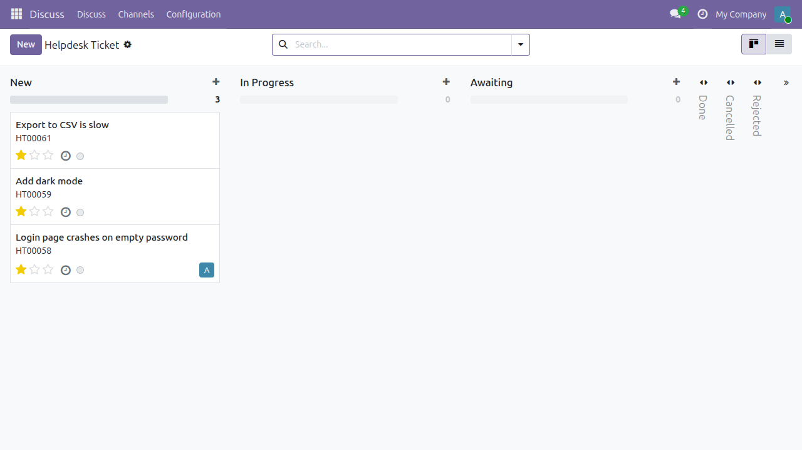
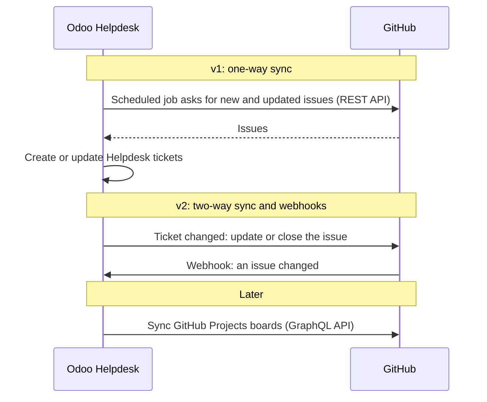
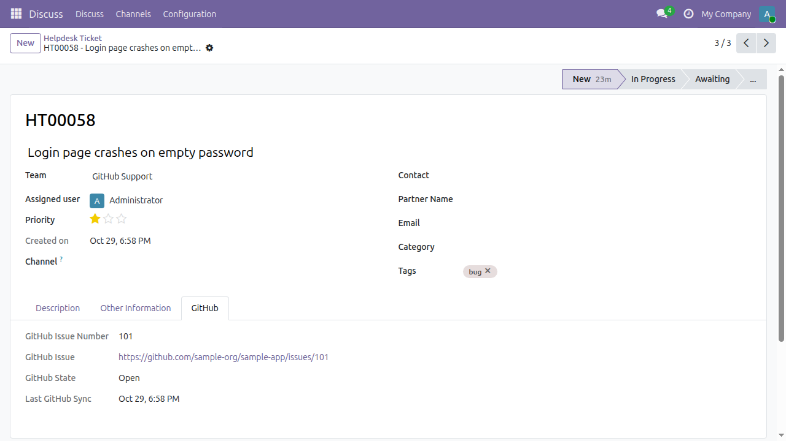

# Helpdesk GitHub Sync

An Odoo 19 module that imports the issues of a GitHub repository into an Odoo
Helpdesk team as tickets (OCA `helpdesk_mgmt`), and keeps them up to date
with a scheduled job.



## How Odoo and GitHub talk



## What v1 does

- Links a Helpdesk team (`helpdesk.ticket.team`, from the OCA
  [`helpdesk_mgmt`](https://github.com/OCA/helpdesk) module) to a GitHub
  repository (`owner/name`).
- Imports every issue as a Helpdesk ticket and updates it on later runs.
  Running the sync again never creates duplicates, even if a ticket was
  archived. Pull requests are skipped.
- Maps the issue to the ticket:

  | GitHub | Odoo ticket |
  | --- | --- |
  | Title | Title |
  | Body | Description (plain text). A placeholder is used when the body is empty, because `helpdesk_mgmt` requires a description |
  | Labels | Tags (reused by name, created when missing) |
  | Assignees | Assigned user: the first assignee whose GitHub Login matches a user allowed on the team (see below) |
  | Open / closed / reopened | The team's first open stage / first closed stage / first open stage, or the stages chosen on the team |
  | Number, URL, state | Read-only GitHub tab on the ticket |
  | Author, comments | Not imported. The ticket's customer (`partner_id`) is not set from GitHub |

- Runs every hour, and on demand with the **Sync now** button.
- Posts sync errors (bad token, rate limit, repository not found, timeout)
  in the team's chatter instead of failing silently.

**Assignee rule.** A ticket has a single assigned user, and `helpdesk_mgmt`
only allows members of the team when the team has members. The sync
therefore picks the first GitHub assignee who has a user with that GitHub
Login and, if the team has members, is one of them. If nobody qualifies the
ticket is left unassigned.

**Stages.** "First open stage" and "first closed stage" are the first
stages, in stage order, that the team can use (stages without a team, or
stages of this team) and that are not closed or are closed. The two
fields on the GitHub tab of the team override this. A ticket whose issue
stays open keeps the stage you moved it to in Odoo. Only a reopened issue
moves the ticket back to an open stage.

GitHub is the source of truth in v1. Changes made in Odoo to the synced
fields (title, description, tags, assignee) are overwritten on the next
sync that sees the issue change. Other ticket fields are left alone.
Creating tickets does not notify the assignee by email.



_The screenshots use sample issue data on a test database._

## Setup

1. Install the Python dependency: `pip install requests`.
2. Install the OCA
   [`helpdesk_mgmt`](https://github.com/OCA/helpdesk) module (branch
   `19.0`) and put this repository in your Odoo addons path. The folder
   must be named `helpdesk_mgmt_github`.
3. Update the apps list and install **Helpdesk GitHub Sync**.
4. Create a GitHub
   [fine-grained personal access token](https://github.com/settings/personal-access-tokens)
   with read-only access to **Issues** on the repositories you want to sync.
   For public repositories the token is optional, but GitHub then allows
   only 60 requests per hour.
5. In **Settings › Helpdesk › GitHub**, paste the token. It is stored as a
   system parameter that only administrators can read.
6. On a Helpdesk team (**Helpdesk › Configuration › Teams**), open the
   **GitHub** tab, enter the repository as `owner/name`, and tick **Sync
   with GitHub**. You can also choose the stages for open and closed
   issues. Helpdesk managers can edit this tab.
7. Optional: set **GitHub Login** on each user (user form, Preferences tab)
   so that issue assignees become ticket assignees.
8. Click **Sync now**, or wait for the hourly **Helpdesk: Sync GitHub
   issues** scheduled action.

## Not done yet

- Changes in Odoo are not sent back to GitHub (planned for v2).
- No webhooks, so updates arrive with the next scheduled run.
- The ticket's customer (`partner_id`) is not set from the GitHub author.
- Only one assignee is used, because a ticket has a single assigned user.
- Issue bodies are shown as plain text. Markdown is not rendered.
- Issue comments are not imported.
- One token for the whole database, not one per team or per user.
- GitHub Projects boards are not synced.

## Roadmap

- **v1 (current):** one-way sync of GitHub issues into Odoo Helpdesk
  tickets, with a scheduled job.
- **v2:** two-way sync, so changes to an Odoo ticket update the issue, plus
  webhooks for near-real-time updates.
- **Later:** GitHub Projects boards.

## Development

Run the linters with [pre-commit](https://pre-commit.com):

```sh
pre-commit install
pre-commit run --all-files
```

Run the tests on a throwaway database. They mock GitHub, so they work
offline:

```sh
odoo-bin -d test_github_sync -i helpdesk_mgmt_github --test-tags /helpdesk_mgmt_github --stop-after-init
```

## License

LGPL-3. See [LICENSE](LICENSE).
