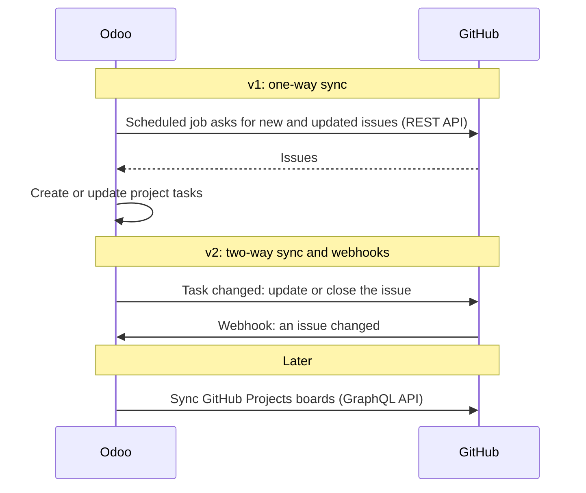

# GitHub Projects Sync

An Odoo 19 module that keeps Odoo project tasks in sync with the issues of a
GitHub repository.

## How Odoo and GitHub talk



## Roadmap

- **v1 (in progress):** one-way sync of GitHub issues into Odoo project
  tasks, with a scheduled job.
- **v2:** two-way sync, so changes to an Odoo task update the issue, plus
  webhooks for near-real-time updates.
- **Later:** GitHub Projects boards.

## Installation

1. Install the Python dependency: `pip install requests`.
2. Put this repository in your Odoo addons path. The folder must be named
   `github_projects_sync`.
3. Update the apps list and install **GitHub Projects Sync**.

## Development

Run the linters with [pre-commit](https://pre-commit.com):

```sh
pre-commit install
pre-commit run --all-files
```

Run the tests on a throwaway database:

```sh
odoo-bin -d test_github_sync -i github_projects_sync --test-tags /github_projects_sync --stop-after-init
```

## License

LGPL-3. See [LICENSE](LICENSE).
