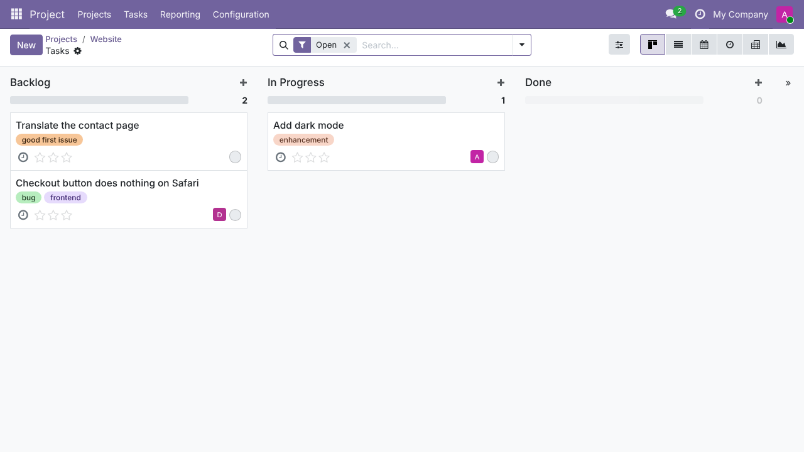
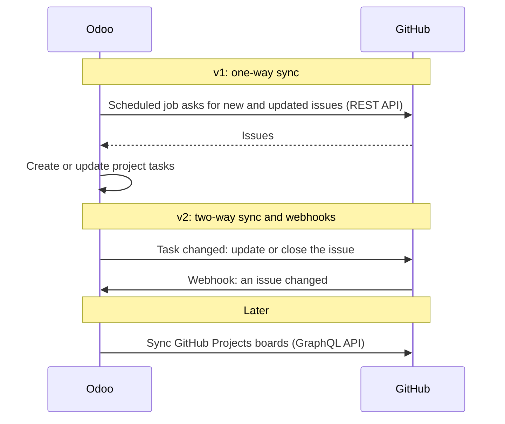
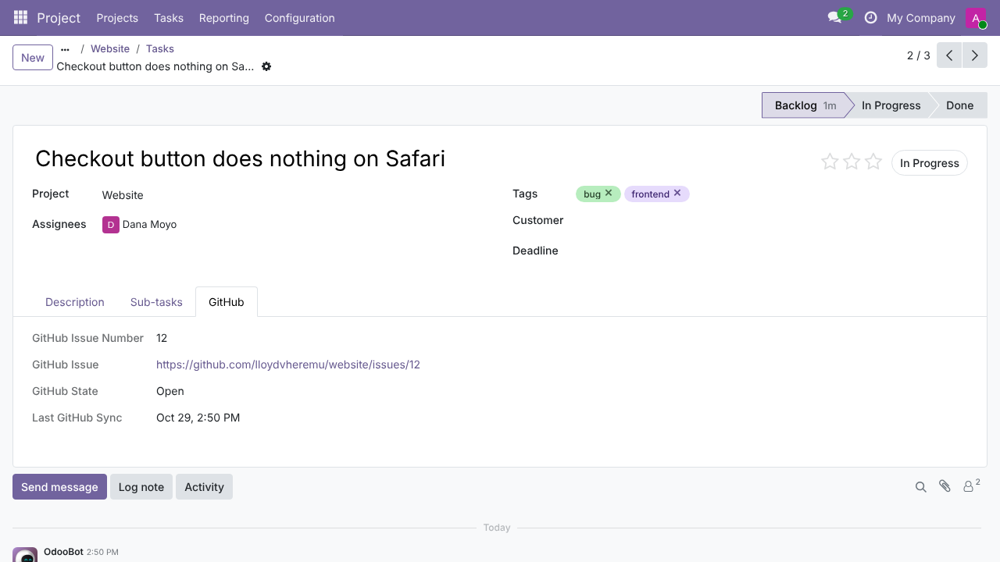

# GitHub Projects Sync

An Odoo 19 module that imports the issues of a GitHub repository into an Odoo
project as tasks, and keeps them up to date with a scheduled job.



## How Odoo and GitHub talk



## What v1 does

- Links an Odoo project to a GitHub repository (`owner/name`).
- Imports every issue as a task and updates it on later runs. Running the
  sync again never creates duplicates. Pull requests are skipped.
- Maps the issue to the task:

  | GitHub | Odoo task |
  | --- | --- |
  | Title | Name |
  | Body | Description (plain text) |
  | Labels | Tags (created when missing) |
  | Assignees | Assignees, matched through each user's GitHub Login |
  | Closed / closed as not planned / reopened | Done / Cancelled / In Progress |
  | Open or closed | Optional stage per project |
  | Number, URL, state | Read-only GitHub tab on the task |

- Runs every hour, and on demand with the **Sync now** button.
- Posts sync errors (bad token, rate limit, repository not found, timeout)
  in the project's chatter instead of failing silently.

GitHub is the source of truth in v1. Changes made in Odoo to the synced
fields are overwritten on the next sync. Other task fields are left alone.



_The screenshots use sample issue data on a test database._

## Setup

1. Install the Python dependency: `pip install requests`.
2. Put this repository in your Odoo addons path. The folder must be named
   `github_projects_sync`.
3. Update the apps list and install **GitHub Projects Sync**.
4. Create a GitHub
   [fine-grained personal access token](https://github.com/settings/personal-access-tokens)
   with read-only access to **Issues** on the repositories you want to sync.
   For public repositories the token is optional, but GitHub then allows
   only 60 requests per hour.
5. In **Settings › Project › GitHub**, paste the token. It is stored as a
   system parameter that only administrators can read.
6. On a project, open the **GitHub** tab, enter the repository as
   `owner/name`, and tick **Sync with GitHub**. You can also choose the
   stages for open and closed issues.
7. Optional: set **GitHub Login** on each user (user form, Preferences tab)
   so that issue assignees become task assignees.
8. Click **Sync now**, or wait for the hourly **Project: Sync GitHub
   issues** scheduled action.

## Not done yet

- Changes in Odoo are not sent back to GitHub. The old
  `create_github_issue()` placeholder is still there and does not call
  the API.
- No webhooks, so updates arrive with the next scheduled run.
- Issue bodies are shown as plain text. Markdown is not rendered.
- Issue comments are not imported.
- One token for the whole database, not one per project or per user.
- GitHub Projects boards are not synced.

## Roadmap

- **v1 (current):** one-way sync of GitHub issues into Odoo project
  tasks, with a scheduled job.
- **v2:** two-way sync, so changes to an Odoo task update the issue, plus
  webhooks for near-real-time updates.
- **Later:** GitHub Projects boards.

## Development

Run the linters with [pre-commit](https://pre-commit.com):

```sh
pre-commit install
pre-commit run --all-files
```

Run the tests on a throwaway database. They mock GitHub, so they work
offline:

```sh
odoo-bin -d test_github_sync -i github_projects_sync --test-tags /github_projects_sync --stop-after-init
```

## License

LGPL-3. See [LICENSE](LICENSE).
