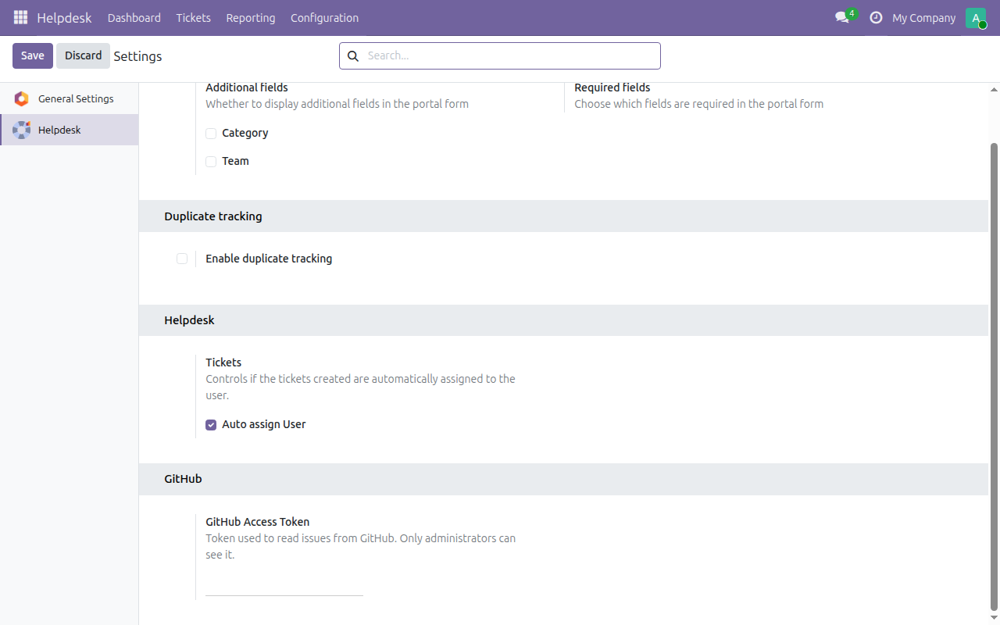
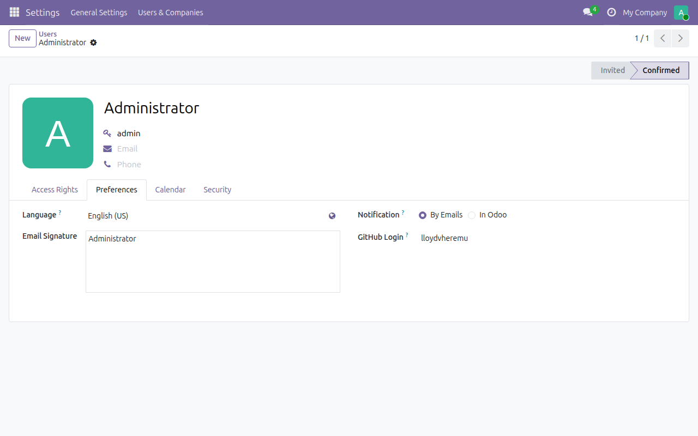

To configure this module, you need to:

1.  Install the Python dependency: `pip install requests`.
2.  Create a GitHub [fine-grained personal access token](https://github.com/settings/personal-access-tokens)
    with read-only access to *Issues* on the repositories you want to
    sync. For public repositories the token is optional, but GitHub then
    allows only 60 requests per hour.
3.  Go to *Settings \> Helpdesk \> GitHub* and paste the token. It is
    stored as a system parameter that only administrators can read.

    

4.  Optional: open a user (*Settings \> Users & Companies \> Users*),
    go to the *Preferences* tab and set the *GitHub Login*. Issues
    assigned to that GitHub account are then assigned to this user. The
    login is unique, ignoring case.

    
