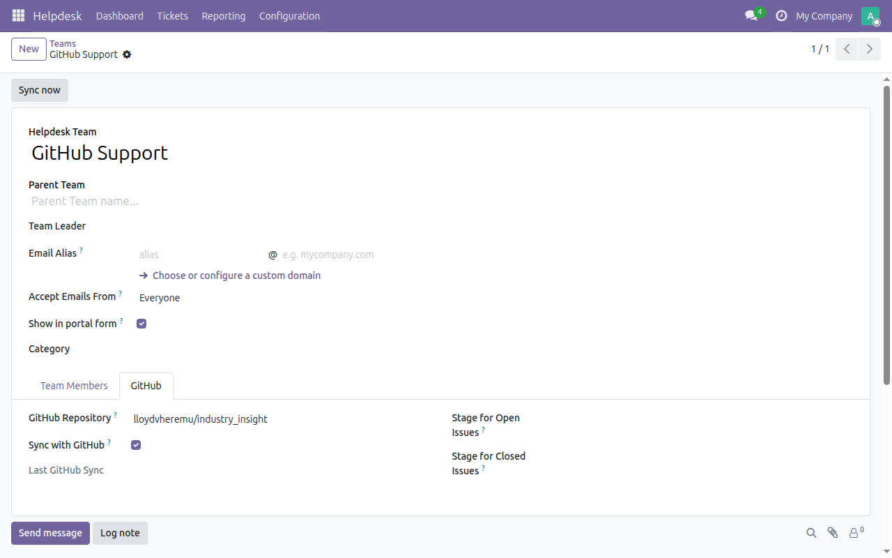
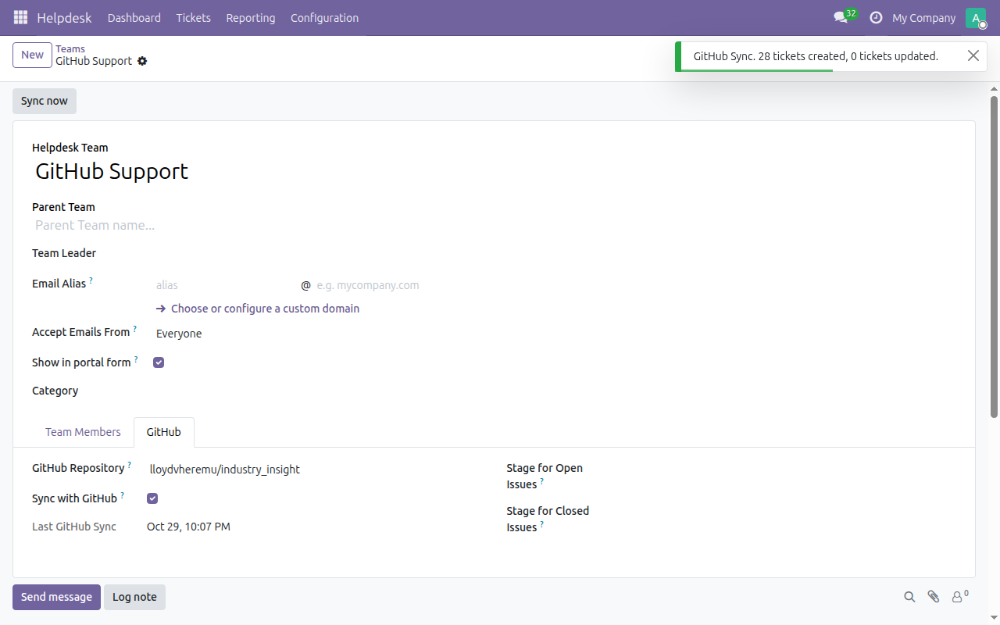
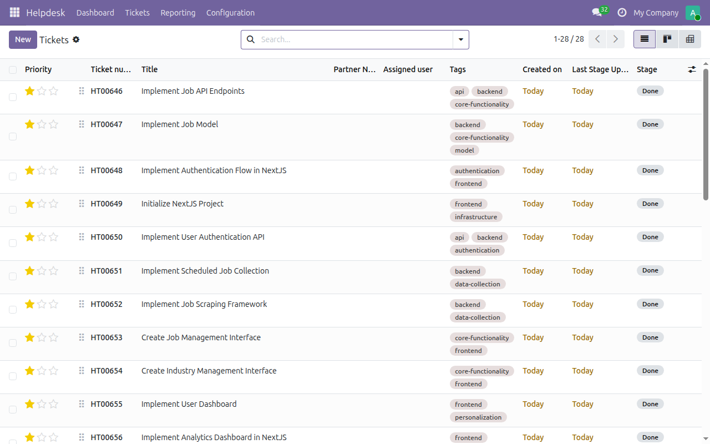
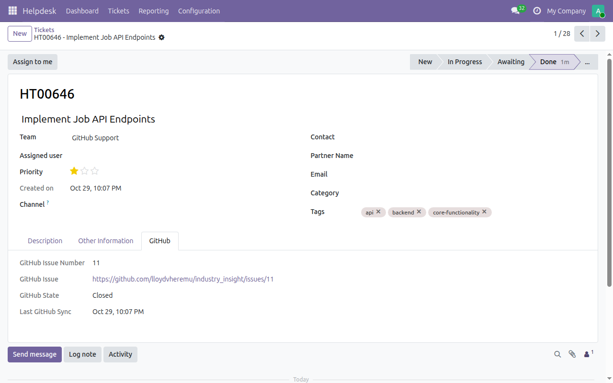

To link a team to a repository:

1.  Go to *Helpdesk \> Configuration \> Teams* and open a team. You must
    be a Helpdesk manager.
2.  Open the *GitHub* tab, enter the repository as `owner/name` and tick
    *Sync with GitHub*. Optionally choose the stage for open issues and
    the stage for closed issues. Without a choice, the team's first open
    and first closed stages are used.

    

3.  Click *Sync now*, or wait for the hourly scheduled action
    *Helpdesk: Sync GitHub issues*. A notification shows how many tickets
    were created and updated.

    

4.  The issues are now in *Helpdesk \> Tickets*, with their labels as
    tags.

    

5.  Open a ticket and use its *GitHub* tab to see the issue number, a
    link to the issue, its state and the time of the last sync.

    

Running the sync again never creates duplicates, even if a ticket was
archived. If GitHub returns an error (bad token, rate limit, repository
not found, timeout), it is posted in the team's chatter and the last sync
time is not advanced, so the next run fetches the same issues again.

The screenshots show a test database with the public repository
`lloydvheremu/industry_insight`.
